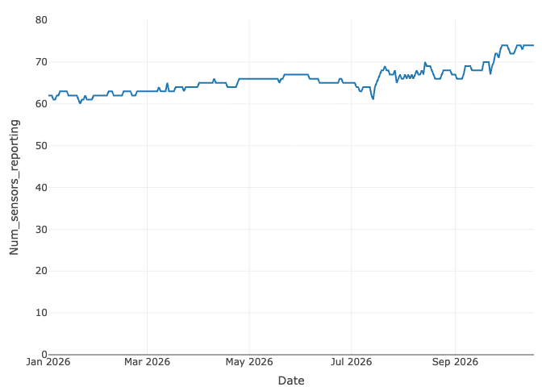
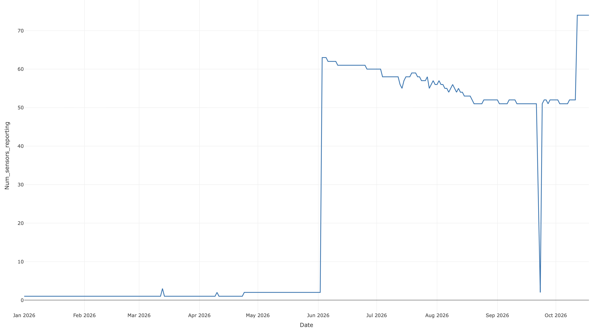

This file contains all the code I used to query and update the CLEAR lab
air quality database during my role as CLEAR lab Database Manager during
the 2026-2027 school year. The role commenced on September 21, 2026.

    library(tidyverse)

    ## Warning: package 'ggplot2' was built under R version 4.4.3

    ## Warning: package 'tibble' was built under R version 4.4.3

    ## Warning: package 'tidyr' was built under R version 4.4.3

    ## Warning: package 'readr' was built under R version 4.4.3

    ## Warning: package 'purrr' was built under R version 4.4.3

    ## Warning: package 'dplyr' was built under R version 4.4.3

    ## ── Attaching core tidyverse packages ──────────────────────── tidyverse 2.0.0 ──
    ## ✔ dplyr     1.2.0     ✔ readr     2.1.6
    ## ✔ forcats   1.0.1     ✔ stringr   1.6.0
    ## ✔ ggplot2   4.0.2     ✔ tibble    3.3.1
    ## ✔ lubridate 1.9.4     ✔ tidyr     1.3.2
    ## ✔ purrr     1.2.1     
    ## ── Conflicts ────────────────────────────────────────── tidyverse_conflicts() ──
    ## ✖ dplyr::filter() masks stats::filter()
    ## ✖ dplyr::lag()    masks stats::lag()
    ## ℹ Use the conflicted package (<http://conflicted.r-lib.org/>) to force all conflicts to become errors

    library(readxl)
    library(httr)
    library(jsonlite)

    ## 
    ## Attaching package: 'jsonlite'
    ## 
    ## The following object is masked from 'package:purrr':
    ## 
    ##     flatten

    library(lubridate)
    library(PurpleAirAPI)
    library(DBI)

    ## Warning: package 'DBI' was built under R version 4.4.3

    library(odbc)

    ## Warning: package 'odbc' was built under R version 4.4.3

    library(PurpleAir)

    con = dbConnect(
      odbc(),
      Driver = "/opt/homebrew/lib/libmsodbcsql.18.dylib",
      Server = "resdbsprdhs02.adms.luc.edu",
      Database = "clearlab_purpleair",
      UID = Sys.getenv("DB_USERNAME"),
      PWD = Sys.getenv("DB_PASSWORD"),
      Encrypt = "yes",
      TrustServerCertificate = "yes"
    )

\#September 2026

### 9/21/26:

After orienting a fellow lab member with the updated database schema and
the high level workflow of the R scripts used to update the Purpleair,
Clarity, and Airgradient tables, the very first change I made was to
update the sensor\_activity\_status column for each sensor company, so
that it determined whether a sensor was active based on a period of time
relative to the current date instead of relative to a fixed date.

At the request of my supervisor, who was my mentor during my Summer 2026
USRE project, I investigated reported sparseness in Purpleair sensors’
historical data during 2026. I did this by seeing which sensors pulled
data during 2025 and which sensors pulled data during 2026, and then
comparing those two sets of sensors.

### 9/24/26:

My supervisor then gave me a list of 4 Loyola owned Purpleair sensors
that were not in the database, for which I downloaded metadata and
historical data and updated the respective tables.

    fields=c("date_created", "last_seen", "name", "location_type", "model", "hardware", "latitude", "longitude", "private")
    newdata <- getPurpleairSensors_debugged(apiReadKey=api_key, fields=fields) 

    #This was a version of the getPurpleairSensors function, which I had previously edited to pull additional metadata fields in order to match the schema of the Purpleair_sensor_information table (see the Week 2 section of my Summer_2026_Air_Quality_Research Github repository for details about this).

    newdata_new_sensors<-newdata%>%
    filter(sensor_index %in% c("309628", "309644", "304778", "304768"))
    newdata_new_sensors

Metadata for only 3 of the desired sensor indices was pulled from the
API (the index 304778 was not). Regardless, I appended the metadata I
could retrieve to the Purpleair\_sensor\_information table.

    dbWriteTable(
      con,
      name="Purpleair_sensor_information",
      value=newdata_new_sensors, 
      append=TRUE,
      row.names=FALSE)

    #I then attempted to download historical data for all four sensors in my supervisor's list.

    api_key<-Sys.getenv("API_KEY")
    sensor_index <- c("309628", "309644", "304778", "304768")

    start_date <- "2024-01-01"
    end_date   <- "2026-09-24"
    average <- "60"  # hourly
    fields <- c(
      "humidity",
      "temperature",
      "pressure",
      "pm2.5_cf_1_a",
      "pm2.5_cf_1_b",
      "rssi"
    )

    historical_data <- getSensorHistory(
      sensorIndex = sensor_index,
      apiReadKey  = api_key,
      startDate   = start_date,
      endDate     = end_date,
      average     = average,
      fields      = fields
    )

    table(historical_data$sensor_index)

Not only did the API’s historical data not contain readings for all 4
sensors, but the 3 sensors that did have historical readings (304768,
304778, and 309644) were a different set of 3 than the sensors that had
metadata (304768, 309628,and 309644). This means that only 2 of the 4
sensors had both historical data and metadata, and of those 2, one had
only 30 historical observations. Regardless, I updated the database with
all the historical data available at the time.

    dbWriteTable(con,
                 name="Purpleair_air_history",
                 value=historical_data, 
                 append=TRUE,
                 row.names=FALSE)

### 9/25/26:

I downloaded historical Airgradient sensor data for 7/5/26-7/20/26 (the
week with the worst air quality of the summer in the Chicago area and
the week prior to that), in order to provide the data to two graduate
students working in the lab, so they could use it for a co-location
study.

    Sys.getenv("LUC_CLEAR_AIRGRADIENT_API_KEY")

    Airgradient_sensor_information<-dbGetQuery(con, "SELECT * FROM Airgradient_sensor_information")

    library(httr)
    library(jsonlite)
    library(dplyr)
    token=Sys.getenv("LUC_CLEAR_AIRGRADIENT_API_KEY")
    location_ids <- c("190848", "190849", "190850", "190851", "190852", "190853", "190854", "190855", "190856", "190857", "190858", "190859", "190860", "190861", "190862", "190863", "190864")

    all_data <- list()

    for (id in location_ids){
      url <- paste0("https://api.airgradient.com/public/api/v1/locations/", id, "/measures/past")
      
      response <- GET(
        url,
        query = list(
          token = token,
          from = "2026-07-05",
          to   = "2026-07-12")
      )
      
      if (status_code(response) != 200) {
        warning("Request failed for sensor ", id, " with status ", status_code(response))
        next
      }
      
      json_text <- content(response, as = "text", encoding = "UTF-8")
      df <- fromJSON(json_text, flatten = TRUE)
      
      df$location_id <- id
      
      all_data[[id]] <- df
    }

    final_df_1 <- bind_rows(all_data)

    #Owing to the fact that Airgradient's API only allows a date range up to a week long for historical data requests, I had to perform two requests and then combine the resulting dataframes together.

    all_data_2 <- list()

    for (id in location_ids){
      url <- paste0("https://api.airgradient.com/public/api/v1/locations/", id, "/measures/past")
      
      response <- GET(
        url,
        query = list(
          token = token,
          from = "2026-07-13",
          to   = "2026-07-20")
      )
      
      if (status_code(response) != 200) {
        warning("Request failed for sensor ", id, " with status ", status_code(response))
        next
      }
      
      json_text <- content(response, as = "text", encoding = "UTF-8")
      df <- fromJSON(json_text, flatten = TRUE)
      
      df$location_id <- id
      
      all_data_2[[id]] <- df
    }

    final_df_2 <- bind_rows(all_data_2)

    July_5_thru_20_Airgradient_data<-bind_rows(final_df_1, final_df_2)[ ,-27] #The 27th column is simply a repeat of the locationID field

    July_5_thru_20_Airgradient_Data<-write.csv(July_5_thru_20_Airgradient_data, file="July_5_thru_20_Airgradient_Data", row.names=FALSE)

### 9/30/26: downloading all Airgradient data between 7pm on 9/28 and 7pm on 9/30 for the co-location study

    library(httr)
    library(jsonlite)
    library(dplyr)
    token=Sys.getenv("LUC_CLEAR_AIRGRADIENT_API_KEY")
    location_ids <- c("190848", "190849", "190850", "190851", "190852", "190853", "190854", "190855", "190856", "190857", "190858", "190859", "190860", "190861", "190862", "190863", "190864")

    all_data_9_28_thru_30 <- list()

    for (id in location_ids){
      url <- paste0("https://api.airgradient.com/public/api/v1/locations/", id, "/measures/past")
      
      response <- GET(
        url,
        query = list(
          token = token,
          from = "2026-09-27",
          to   = "2026-10-01")
      )
      
      if (status_code(response) != 200) {
        warning("Request failed for sensor ", id, " with status ", status_code(response))
        next
      }
      
      json_text <- content(response, as = "text", encoding = "UTF-8")
      df <- fromJSON(json_text, flatten = TRUE)
      
      df$location_id <- id
      
      all_data_9_28_thru_30[[id]] <- df
    }

    final_df <- bind_rows(all_data_9_28_thru_30)

    nrow(final_df)

    New_airgradient_historical_data<-final_df%>%
      select(location_id, locationName, timestamp, pm01, pm01_corrected, pm02, pm02_corrected, pm10, pm10_corrected, atmp, atmp_corrected, rhum, rhum_corrected, rco2, rco2_corrected, tvoc)

    New_airgradient_historical_data$timestamp <- as.POSIXct(
      New_airgradient_historical_data$timestamp,
      format = "%Y-%m-%dT%H:%M:%OS",
      tz = "UTC")

    max(New_airgradient_historical_data$timestamp)
    head(New_airgradient_historical_data$timestamp)
    sum(is.na(New_airgradient_historical_data$timestamp))

    New_airgradient_historical_data_filtered<-New_airgradient_historical_data%>%
    filter(timestamp <= as.POSIXct("2026-09-30 19:00:00"))

    max(New_airgradient_historical_data_filtered$timestamp)
    class(New_airgradient_historical_data_filtered$timestamp)

    cutoff_1 <- as.POSIXct(
      "2026-09-30 19:00:00",
      tz = "UTC"
    )

    cutoff_2 <- as.POSIXct(
      "2026-09-28 17:00:00",
      tz = "UTC"
    )

    New_airgradient_historical_data_filtered <-
      New_airgradient_historical_data %>%
      filter(timestamp <= cutoff_1 & timestamp >= cutoff_2)

    max(New_airgradient_historical_data_filtered$timestamp)
    min(New_airgradient_historical_data_filtered$timestamp)

    Airgradient_calibration_data<-write.csv(New_airgradient_historical_data_filtered, file="Airgradient_sensor_calibration_data.csv", row.names=FALSE)

    Airgradient_Calibration_data<-read_csv("~/Desktop/CLEAR lab database mangement 26-27/CLEAR_lab_database_work/Airgradient_sensor_calibration_data.csv")

    nrow(Airgradient_Calibration_data)

### 10/1/26: downloading historical data for four Purpleair sensors between 7pm on 9/28 and 7pm on 9/30 for the co-location study (to co locate with the Airgradient sensors)

    api_key<-Sys.getenv("PURPLE_AIR_API_KEY")

    sensor_index<-c("304768", "309628", "309644", "310423")

    start_date <- "2026-09-28"
    end_date   <- "2026-09-30"
    average <- "0" 
    fields <- c(
      "humidity",
      "temperature",
      "pressure",
      "pm2.5_cf_1_a",
      "pm2.5_cf_1_b",
      "rssi"
    )

    historical_data <- getSensorHistory(
      sensorIndex = sensor_index,
      apiReadKey  = api_key,
      startDate   = start_date,
      endDate     = end_date,
      fields      = fields,
      average     = average
    )

    ## Sensor 1 of 4 (ID: 304768), Interval: 2026-09-28 to 2026-09-30 Sensor 2 of 4
    ## (ID: 309628), Interval: 2026-09-28 to 2026-09-30 Sensor 3 of 4 (ID: 309644),
    ## Interval: 2026-09-28 to 2026-09-30 Sensor 4 of 4 (ID: 310423), Interval:
    ## 2026-09-28 to 2026-09-30

    nrow(historical_data)

    ## [1] 7491

    table(historical_data$sensor_index)

    ## 
    ## 304768 309628 309644 310423 
    ##   2157   1591   2158   1585

    max(historical_data$time_stamp)

    ## [1] "2026-09-30 23:59:24"

    historical_data<-historical_data%>%
    filter(time_stamp >= "2026-09-28 18:58:00" & time_stamp <= "2026-09-30 19:02:00")

    Purpleair_calibration_data<-write.csv(historical_data, file="Purple_air_sensor_calibration_data.csv", row.names=FALSE)

    Purpleair_Calibration_data<-read_csv("~/Desktop/CLEAR lab database mangement 26-27/CLEAR_lab_database_work/Purple_air_sensor_calibration_data.csv")

    ## Rows: 5760 Columns: 8
    ## ── Column specification ────────────────────────────────────────────────────────
    ## Delimiter: ","
    ## dbl  (7): rssi, humidity, temperature, pressure, pm2.5_cf_1_a, pm2.5_cf_1_b,...
    ## dttm (1): time_stamp
    ## 
    ## ℹ Use `spec()` to retrieve the full column specification for this data.
    ## ℹ Specify the column types or set `show_col_types = FALSE` to quiet this message.

    nrow(Purpleair_Calibration_data)

    ## [1] 5760

\#10/5/26: adding additional Airgradient sensors to the database based
on a file sent by a former student CLEAR lab employee several months ago

    Airgradient_sensor_information<-dbGetQuery(con, "SELECT * FROM Airgradient_sensor_information")

    library(httr)
    library(jsonlite)
    library(dplyr)
    token <- Sys.getenv("LUC_CLEAR_AIRGRADIENT_API_KEY")
    location_ids <- c("59983", "59297", "163250", "75775", "171390", "163298", "58933", "77131")

    from_time = format(Sys.time() - 864000, "%Y-%m-%dT%H:%M:%SZ", tz = "UTC")
    to_time   = format(Sys.time(), "%Y-%m-%dT%H:%M:%SZ", tz = "UTC")

    all_data <- list()

    for (id in location_ids){
      url <- paste0("https://api.airgradient.com/public/api/v1/locations/", id, "/measures/past")
      
      response <- GET(
        url,
        query = list(
          token = token,
          from = from_time,
          to   = to_time)
      )
      
      if (status_code(response) != 200) {
        warning("Request failed for sensor ", id, " with status ", status_code(response))
        next
      }
      
      json_text <- content(response, as = "text", encoding = "UTF-8")
      df <- fromJSON(json_text, flatten = TRUE)
      
      df$location_id <- id
      
      all_data[[id]] <- df
    }

    Airgradient_chunk_1 <- bind_rows(all_data)

    Airgradient_chunk_1

    ## # A tibble: 8 × 1
    ##   location_id
    ##   <chr>      
    ## 1 59983      
    ## 2 59297      
    ## 3 163250     
    ## 4 75775      
    ## 5 171390     
    ## 6 163298     
    ## 7 58933      
    ## 8 77131

None of these sensors contained any sensor metadata or historical data
on the API. My supervisor told me to revisit this at a later point after
she had done some investigating as to why this is the case.

### 10/12/26: downloading PurpleAir data based on a list of sensor indices Dr. Whalen sent me (after updating all three databases with their respective update scripts). Some of these sensors are in the city of Chicago proper, while others are outside the city but within Cook County.

### Dr. Whalen wanted me to add all the sensors to the metadata table, but to only add historical data from the Chicago city sensors (this means marking the Cook County sensors as inactive/not pulling in Chicago in the metadata table).

    library(tidyverse)
    New_sensors_to_add<-read_csv("~/Desktop/CLEAR lab database mangement 26-27/CLEAR_lab_database_work/purple air sensors.csv")
    sensor_indices<-c()
    New_sensors_to_add<-New_sensors_to_add%>%
    filter(sensor_index != 'NA')
    for (i in New_sensors_to_add$sensor_index){
      sensor_indices<-c(sensor_indices, i)}

    fields=c("date_created", "last_seen", "name", "location_type", "model", "hardware", "latitude", "longitude", "private")
    api_key<-Sys.getenv("PURPLE_AIR_API_KEY")
    new_metadata<-getPurpleairSensors_debugged(apiReadKey = api_key, fields=fields)
    new_metadata<-new_metadata%>%
    filter(sensor_index %in% sensor_indices)
    Unknown_sensor<-New_sensors_to_add%>%
    filter(sensor_index !in c(new_metadata$sensor_index))

    new_sensor_indices_retrieved<-new_metadata$sensor_index
    print(New_sensors_to_add$sensor_index[which(!(New_sensors_to_add$sensor_index %in% new_sensor_indices_retrieved))])
    #The index 171443 was not in the downloaded metadata. I will try downloading this sensor's metadata separately.

    sensor_171443_metadata<-new_metadata%>%
    filter(sensor_index==171443)
    nrow(sensor_171443_metadata)
    #This did not return any metadata for the sensor. I will add the other 41 sensors to the database and discuss this pesky individual with Dr. Whalen.

    colnames(new_metadata)

    #Moving the 'private' column after the 'longitude' column to match the structure of the database (AI helped me here; I had not seen this method before)

    library(dplyr)
    new_metadata <- new_metadata %>% relocate(private, .after = longitude)

    new_metadata<-new_metadata%>%
    mutate(temp_date_column=as.Date(last_seen))%>%
    mutate(sensor_activity_status=case_when(
      temp_date_column>=Sys.Date()-30 ~ "Active",
      temp_date_column < Sys.Date()-30 ~ "Inactive"
    ))

    #We want the metadata for all these sensors, but we don't want the historical data for the non Chicago sensors.
    Non_Chicago_sensors<-New_sensors_to_add%>%
    filter(Location != "Chicago")%>%
    select(sensor_index)
    Non_Chicago_sensor_indices<-Non_Chicago_sensors$sensor_index

    #This means I need to set the sensor_activity_status column to Inactive for the sensor indices from the Cook County Suburbs (all of the sensors are currently Active based on their last_seen date).

    new_metadata<-new_metadata%>%
    left_join(New_sensors_to_add, by=c("sensor_index"="sensor_index"))

    new_metadata<-new_metadata%>%
    mutate(sensor_activity_status=case_when(
      Location=="Chicago" ~ "Active",
      Location=="Cook County Suburbs" ~ "Inactive (not pulling in Chicago)"
    ))

    New_metadata<-new_metadata%>%
    select(sensor_index, date_created, last_seen, name.y, location_type, model, hardware, latitude.y, longitude.y, private, sensor_activity_status)
    colnames(New_metadata)[4]="name"
    colnames(New_metadata)[8]="latitude"
    colnames(New_metadata)[9]="longitude"

    dbWriteTable(
      con,
      name="Purpleair_sensor_information",
      value=New_metadata, 
      append=TRUE,
      row.names=FALSE)

    c<-dbGetQuery(con, "SELECT * FROM Purpleair_sensor_information")

    #Now, I need to download and append the historical data for the Chicago sensors.

    Chicago_Sensors<-New_sensors_to_add%>%
    filter(Location=="Chicago")
    Chicago_sensor_indices<-Chicago_Sensors$sensor_index #There are 23 such sensors

    sensor_index=Chicago_sensor_indices

    start_date <- "2018-01-01"
    end_date   <- "2026-10-12"
    average <- "0" 
    fields <- c(
      "humidity",
      "temperature",
      "pressure",
      "pm2.5_cf_1_a",
      "pm2.5_cf_1_b",
      "rssi"
    )

    historical_data <- getSensorHistory(
      sensorIndex = sensor_index,
      apiReadKey  = api_key,
      startDate   = start_date,
      endDate     = end_date,
      fields      = fields,
      average     = average
    )

    nrow(historical_data)

    table(historical_data$sensor_index)

    max(historical_data$time_stamp)

    dbWriteTable(con,
                 name="Purpleair_air_history",
                 value=historical_data, 
                 append=TRUE,
                 row.names=FALSE)

This appended 3,025,729 rows to Purpleair\_air\_history.

### 10/18/26: investigating the number of sensors reporting throughout 2026

I investigating the trend in the number of sensors reporting data on
each day throughout the year 2026 as a time series.

    Purpleair_2026_historical_data<-dbGetQuery(con, "SELECT * FROM Purpleair_air_history WHERE time_stamp >= '2026-01-01 00:00:00'")

    Purpleair_2026_investigation_data<-Purpleair_2026_historical_data%>%
    mutate(Date=as.Date(time_stamp))%>%
    arrange(Date)

    Date_list<-as.Date(character())
    Reporting_sensors_list<-c()

    for(i in unique(Purpleair_2026_investigation_data$Date)){
      new_data<-Purpleair_2026_investigation_data%>%
      filter(Date==i)
      Date_list<-c(Date_list, i)
      print(i)
      Num_distinct_reporting_sensors<-length(unique(new_data$sensor_index))
      Reporting_sensors_list<-c(Reporting_sensors_list, Num_distinct_reporting_sensors)}

    ## [1] 20454
    ## [1] 20455
    ## [1] 20456
    ## [1] 20457
    ## [1] 20458
    ## [1] 20459
    ## [1] 20460
    ## [1] 20461
    ## [1] 20462
    ## [1] 20463
    ## [1] 20464
    ## [1] 20465
    ## [1] 20466
    ## [1] 20467
    ## [1] 20468
    ## [1] 20469
    ## [1] 20470
    ## [1] 20471
    ## [1] 20472
    ## [1] 20473
    ## [1] 20474
    ## [1] 20475
    ## [1] 20476
    ## [1] 20477
    ## [1] 20478
    ## [1] 20479
    ## [1] 20480
    ## [1] 20481
    ## [1] 20482
    ## [1] 20483
    ## [1] 20484
    ## [1] 20485
    ## [1] 20486
    ## [1] 20487
    ## [1] 20488
    ## [1] 20489
    ## [1] 20490
    ## [1] 20491
    ## [1] 20492
    ## [1] 20493
    ## [1] 20494
    ## [1] 20495
    ## [1] 20496
    ## [1] 20497
    ## [1] 20498
    ## [1] 20499
    ## [1] 20500
    ## [1] 20501
    ## [1] 20502
    ## [1] 20503
    ## [1] 20504
    ## [1] 20505
    ## [1] 20506
    ## [1] 20507
    ## [1] 20508
    ## [1] 20509
    ## [1] 20510
    ## [1] 20511
    ## [1] 20512
    ## [1] 20513
    ## [1] 20514
    ## [1] 20515
    ## [1] 20516
    ## [1] 20517
    ## [1] 20518
    ## [1] 20519
    ## [1] 20520
    ## [1] 20521
    ## [1] 20522
    ## [1] 20523
    ## [1] 20524
    ## [1] 20525
    ## [1] 20526
    ## [1] 20527
    ## [1] 20528
    ## [1] 20529
    ## [1] 20530
    ## [1] 20531
    ## [1] 20532
    ## [1] 20533
    ## [1] 20534
    ## [1] 20535
    ## [1] 20536
    ## [1] 20537
    ## [1] 20538
    ## [1] 20539
    ## [1] 20540
    ## [1] 20541
    ## [1] 20542
    ## [1] 20543
    ## [1] 20544
    ## [1] 20545
    ## [1] 20546
    ## [1] 20547
    ## [1] 20548
    ## [1] 20549
    ## [1] 20550
    ## [1] 20551
    ## [1] 20552
    ## [1] 20553
    ## [1] 20554
    ## [1] 20555
    ## [1] 20556
    ## [1] 20557
    ## [1] 20558
    ## [1] 20559
    ## [1] 20560
    ## [1] 20561
    ## [1] 20562
    ## [1] 20563
    ## [1] 20564
    ## [1] 20565
    ## [1] 20566
    ## [1] 20567
    ## [1] 20568
    ## [1] 20569
    ## [1] 20570
    ## [1] 20571
    ## [1] 20572
    ## [1] 20573
    ## [1] 20574
    ## [1] 20575
    ## [1] 20576
    ## [1] 20577
    ## [1] 20578
    ## [1] 20579
    ## [1] 20580
    ## [1] 20581
    ## [1] 20582
    ## [1] 20583
    ## [1] 20584
    ## [1] 20585
    ## [1] 20586
    ## [1] 20587
    ## [1] 20588
    ## [1] 20589
    ## [1] 20590
    ## [1] 20591
    ## [1] 20592
    ## [1] 20593
    ## [1] 20594
    ## [1] 20595
    ## [1] 20596
    ## [1] 20597
    ## [1] 20598
    ## [1] 20599
    ## [1] 20600
    ## [1] 20601
    ## [1] 20602
    ## [1] 20603
    ## [1] 20604
    ## [1] 20605
    ## [1] 20606
    ## [1] 20607
    ## [1] 20608
    ## [1] 20609
    ## [1] 20610
    ## [1] 20611
    ## [1] 20612
    ## [1] 20613
    ## [1] 20614
    ## [1] 20615
    ## [1] 20616
    ## [1] 20617
    ## [1] 20618
    ## [1] 20619
    ## [1] 20620
    ## [1] 20621
    ## [1] 20622
    ## [1] 20623
    ## [1] 20624
    ## [1] 20625
    ## [1] 20626
    ## [1] 20627
    ## [1] 20628
    ## [1] 20629
    ## [1] 20630
    ## [1] 20631
    ## [1] 20632
    ## [1] 20633
    ## [1] 20634
    ## [1] 20635
    ## [1] 20636
    ## [1] 20637
    ## [1] 20638
    ## [1] 20639
    ## [1] 20640
    ## [1] 20641
    ## [1] 20642
    ## [1] 20643
    ## [1] 20644
    ## [1] 20645
    ## [1] 20646
    ## [1] 20647
    ## [1] 20648
    ## [1] 20649
    ## [1] 20650
    ## [1] 20651
    ## [1] 20652
    ## [1] 20653
    ## [1] 20654
    ## [1] 20655
    ## [1] 20656
    ## [1] 20657
    ## [1] 20658
    ## [1] 20659
    ## [1] 20660
    ## [1] 20661
    ## [1] 20662
    ## [1] 20663
    ## [1] 20664
    ## [1] 20665
    ## [1] 20666
    ## [1] 20667
    ## [1] 20668
    ## [1] 20669
    ## [1] 20670
    ## [1] 20671
    ## [1] 20672
    ## [1] 20673
    ## [1] 20674
    ## [1] 20675
    ## [1] 20676
    ## [1] 20677
    ## [1] 20678
    ## [1] 20679
    ## [1] 20680
    ## [1] 20681
    ## [1] 20682
    ## [1] 20683
    ## [1] 20684
    ## [1] 20685
    ## [1] 20686
    ## [1] 20687
    ## [1] 20688
    ## [1] 20689
    ## [1] 20690
    ## [1] 20691
    ## [1] 20692
    ## [1] 20693
    ## [1] 20694
    ## [1] 20695
    ## [1] 20696
    ## [1] 20697
    ## [1] 20698
    ## [1] 20699
    ## [1] 20700
    ## [1] 20701
    ## [1] 20702
    ## [1] 20703
    ## [1] 20704
    ## [1] 20705
    ## [1] 20706
    ## [1] 20707
    ## [1] 20708
    ## [1] 20709
    ## [1] 20710
    ## [1] 20711
    ## [1] 20712
    ## [1] 20713
    ## [1] 20714
    ## [1] 20715
    ## [1] 20716
    ## [1] 20717
    ## [1] 20718
    ## [1] 20719
    ## [1] 20720
    ## [1] 20721
    ## [1] 20722
    ## [1] 20723
    ## [1] 20724
    ## [1] 20725
    ## [1] 20726
    ## [1] 20727
    ## [1] 20728
    ## [1] 20729
    ## [1] 20730
    ## [1] 20731
    ## [1] 20732
    ## [1] 20733
    ## [1] 20734
    ## [1] 20735
    ## [1] 20736
    ## [1] 20737
    ## [1] 20738
    ## [1] 20739
    ## [1] 20740
    ## [1] 20741
    ## [1] 20742
    ## [1] 20743
    ## [1] 20744

    dates_targeted_inquiry<-as.Date(character())
    for (i in Date_list){
      index=which(Date_list==i)
      if (Reporting_sensors_list[index] <= 5){
        dates_targeted_inquiry<-c(dates_targeted_inquiry, Date_list[index])}
    }

    ts_data_frame<-data.frame(Date=Date_list, Num_sensors_reporting=Reporting_sensors_list)

    #Creating the time series

    library(plotly)

    ## Warning: package 'plotly' was built under R version 4.4.3

    ## 
    ## Attaching package: 'plotly'

    ## The following object is masked from 'package:httr':
    ## 
    ##     config

    ## The following object is masked from 'package:ggplot2':
    ## 
    ##     last_plot

    ## The following object is masked from 'package:stats':
    ## 
    ##     filter

    ## The following object is masked from 'package:graphics':
    ## 
    ##     layout

    Purpleair_sensors_reporting<-plot_ly(data=ts_data_frame, x=~Date, y=~Num_sensors_reporting, type="scatter", mode="lines", col="blue")%>%
    layout(yaxis=list(range=c(0,80)))
    Purpleair_sensors_reporting

    ## Warning: 'scatter' objects don't have these attributes: 'col'
    ## Valid attributes include:
    ## 'alignmentgroup', 'cliponaxis', 'connectgaps', 'customdata', 'customdatasrc', 'dx', 'dy', 'error_x', 'error_y', 'fill', 'fillcolor', 'fillpattern', 'groupnorm', 'hoverinfo', 'hoverinfosrc', 'hoverlabel', 'hoveron', 'hovertemplate', 'hovertemplatesrc', 'hovertext', 'hovertextsrc', 'ids', 'idssrc', 'legend', 'legendgroup', 'legendgrouptitle', 'legendrank', 'legendwidth', 'line', 'marker', 'meta', 'metasrc', 'mode', 'name', 'offsetgroup', 'opacity', 'orientation', 'selected', 'selectedpoints', 'showlegend', 'stackgaps', 'stackgroup', 'stream', 'text', 'textfont', 'textposition', 'textpositionsrc', 'textsrc', 'texttemplate', 'texttemplatesrc', 'transforms', 'type', 'uid', 'uirevision', 'unselected', 'visible', 'x', 'x0', 'xaxis', 'xcalendar', 'xhoverformat', 'xperiod', 'xperiod0', 'xperiodalignment', 'xsrc', 'y', 'y0', 'yaxis', 'ycalendar', 'yhoverformat', 'yperiod', 'yperiod0', 'yperiodalignment', 'ysrc', 'key', 'set', 'frame', 'transforms', '_isNestedKey', '_isSimpleKey', '_isGraticule', '_bbox'

When I initially generated this plot, the line was at 1-3 sensors for
the entire period from January 1 to June 1. I suspect this is because I
initially set the sensor\_activity\_status column based on a static 30
day threshold and only recently (on 9/21/26) changed the column
definition to a moving 30 day threshold relative to the current date.

Here is what the initial plot looked like:

My Screenshot Caption

I then backfilled the sensor data that was unaccounted for prior to me
changing the column definition (going up to the current date just to be
safe).

    vec<-unique(Purpleair_2026_historical_data$sensor_index)

    sensor_index <- vec

    start_date <- "2026-01-01"
    end_date   <- "2026-10-18"
    average <- "60"  
    fields <- c(
      "humidity",
      "temperature",
      "pressure",
      "pm2.5_cf_1_a",
      "pm2.5_cf_1_b",
      "rssi"
    )

    historical_data <- getSensorHistory(
      sensorIndex = sensor_index,
      apiReadKey  = api_key,
      startDate   = start_date,
      endDate     = end_date,
      average     = average,
      fields      = fields
    )

    nrow(historical_data)

    table(historical_data$sensor_index)
    colnames(historical_data)
    historical_data<-historical_data%>%
    mutate(pm_2p5_diff=pm2.5_cf_1_a-pm2.5_cf_1_b)%>%
    mutate(pm2p5_cf_1_a=pm2.5_cf_1_a, pm2p5_cf_1_b=pm2.5_cf_1_b)

    library(dplyr)
    historical_data<-historical_data %>% 
    relocate(sensor_index, .before = time_stamp)%>%
    relocate(humidity, .before = rssi)%>%
    relocate(pm_2p5_diff, .after=pm2p5_cf_1_b)%>%
    relocate(rssi, .before=pm_2p5_diff)%>%
      
    historical_data<-historical_data%>%
    select(-pm2.5_cf_1_a, -pm2.5_cf_1_b)
    colnames(historical_data)[9]="pm2p5_diff"

I then cleaned the duplicates out of Purpleair\_air\_history.

    duplicate_historical_records<- dbGetQuery(con, 
                                    "SELECT
        sensor_index, time_stamp, humidity, temperature, pressure, pm2p5_cf_1_a, pm2p5_cf_1_b, rssi, pm2p5_diff,
        COUNT(*) AS n
    FROM Purpleair_air_history
    GROUP BY sensor_index, time_stamp, humidity, temperature, pressure, pm2p5_cf_1_a, pm2p5_cf_1_b, rssi, pm2p5_diff
    HAVING COUNT(*) > 1")

    dbExecute(con, "
    WITH duplicates AS (
        SELECT *,
               ROW_NUMBER() OVER (
                   PARTITION BY sensor_index, time_stamp, humidity, temperature, pressure, pm2p5_cf_1_a, pm2p5_cf_1_b, rssi, pm2p5_diff
                   ORDER BY sensor_index, time_stamp, humidity, temperature, pressure, pm2p5_cf_1_a, pm2p5_cf_1_b, rssi, pm2p5_diff) 
                   AS rn
        FROM Purpleair_air_history)
    DELETE FROM duplicates
    WHERE rn > 1")

This removed 240,242 duplicate records, which is far fewer than the
number of records added to the database.
